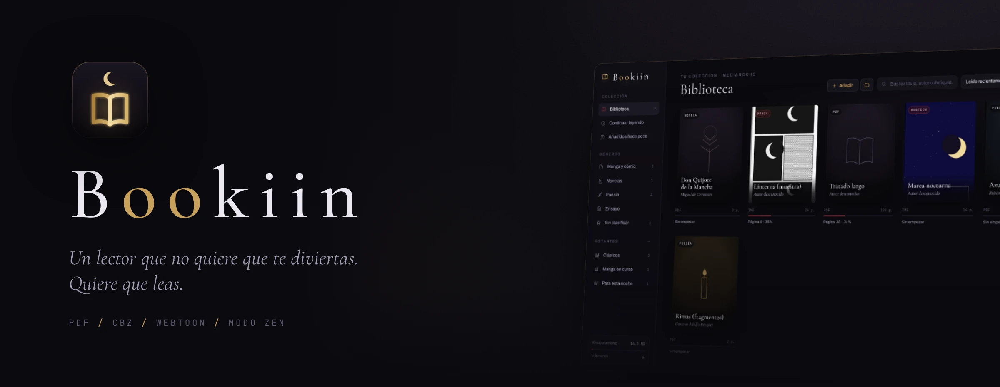
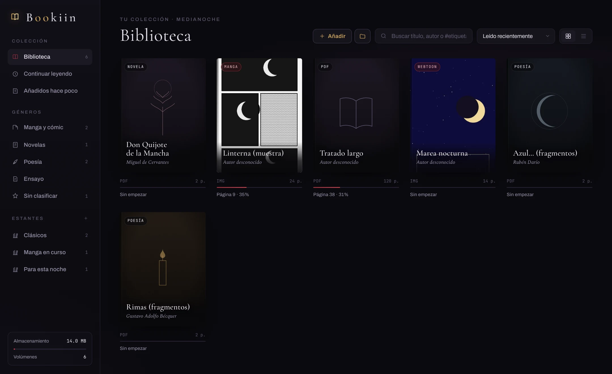
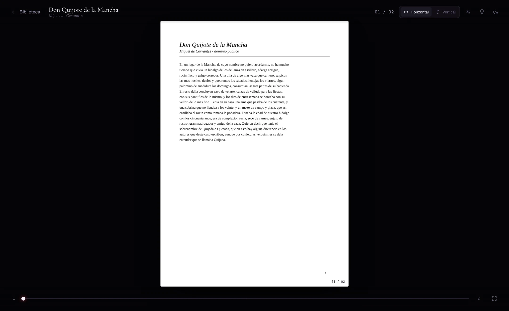
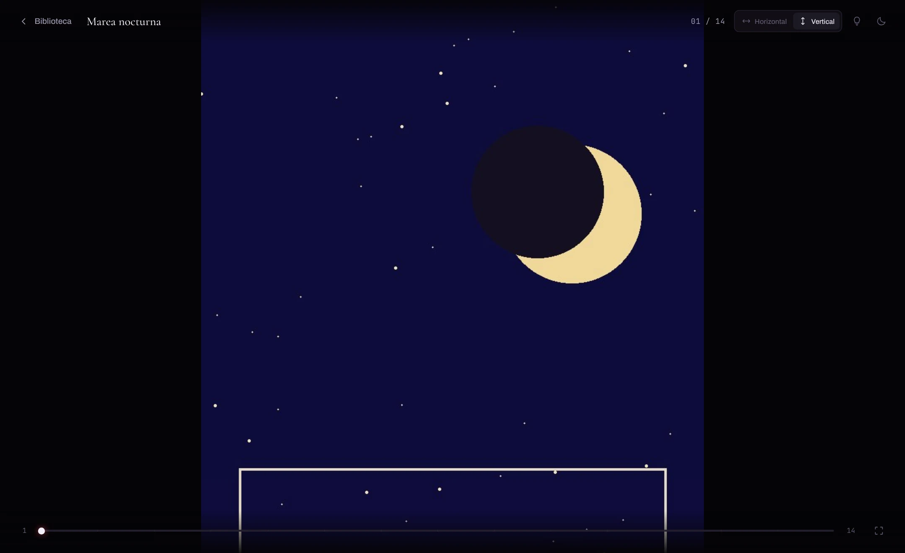
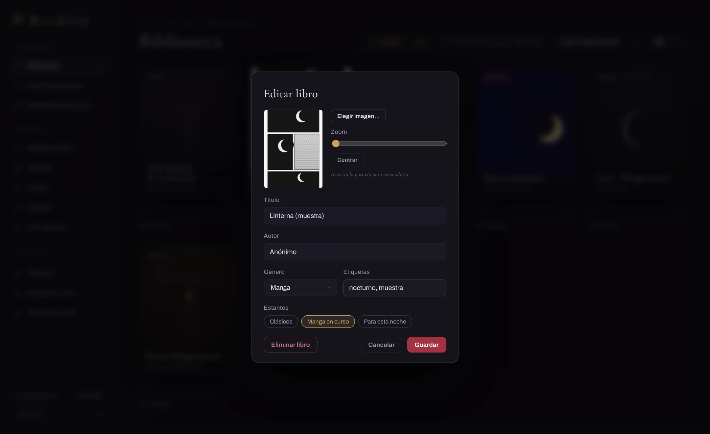
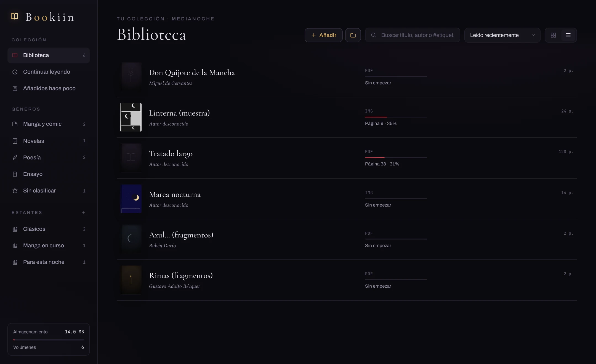
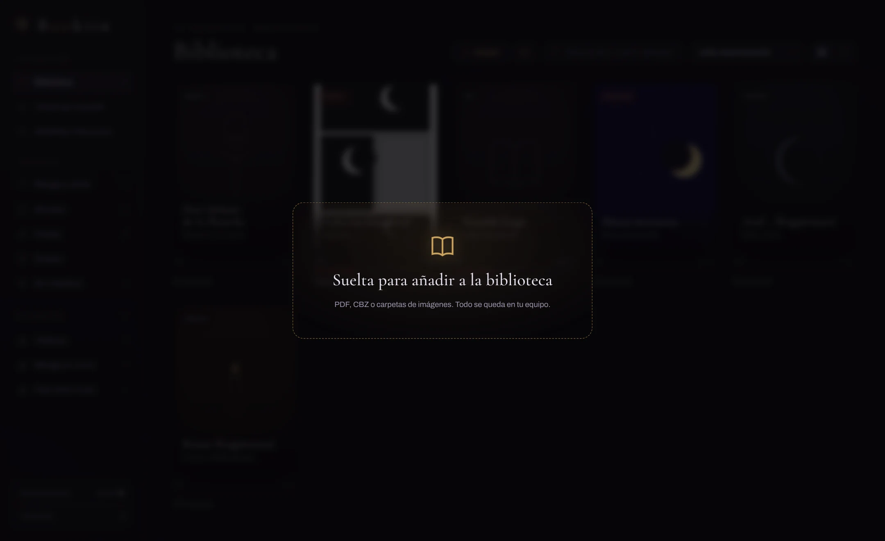
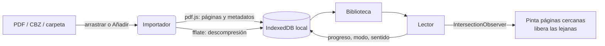

<div align="center">



<br>

<a href="#instalacion"></a>


<br><br>

<a href="#filosofia">Filosofía</a>
&nbsp;&nbsp;·&nbsp;&nbsp;
<a href="#en-imagenes">En imágenes</a>
&nbsp;&nbsp;·&nbsp;&nbsp;
<a href="#caracteristicas">Características</a>
&nbsp;&nbsp;·&nbsp;&nbsp;
<a href="#atajos">Atajos</a>
&nbsp;&nbsp;·&nbsp;&nbsp;
<a href="#instalacion">Instalación</a>
&nbsp;&nbsp;·&nbsp;&nbsp;
<a href="#arquitectura">Arquitectura</a>

</div>

<br>

Bookiin es un lector de escritorio para **PDFs, manga y webtoons**, construido
alrededor de una sola idea: cuando estás leyendo, la interfaz desaparece.
En modo zen no queda nada en pantalla. Ni botones, ni contadores, ni cursor.
Solo la página, flotando en la penumbra, y tú.

<br>

<h2 id="filosofia">Filosofía</h2>

> La mayoría de los lectores son paneles de control disfrazados de libros.
> Bookiin es lo contrario: un cuarto oscuro con una lámpara encendida sobre la mesa.

<table>
<tr>
<td width="33%" valign="top">

**Medianoche**

Fondo casi negro, acento dorado tenue, tipografía serif de otro siglo.
Leer de noche se siente como robar un libro de una biblioteca cerrada.

</td>
<td width="33%" valign="top">

**El chrome se rinde**

Las barras del lector se desvanecen solas cuando dejas el mouse quieto.
En modo zen se rinden del todo, hasta que <kbd>Esc</kbd> las despierte.

</td>
<td width="33%" valign="top">

**Tus libros son tuyos**

Nada sale de tu máquina. Sin cuentas, sin nube, sin telemetría, sin
fuentes descargadas de internet. Funciona igual con el wifi apagado.

</td>
</tr>
</table>

<br>

<h2 id="en-imagenes">En imágenes</h2>

<p align="center">
  
  <br><sub>La biblioteca: géneros automáticos, estantes propios y progreso de cada volumen.</sub>
</p>

<table>
<tr>
<td width="50%">

<p align="center"><sub>Lectura horizontal, una página a la vez.</sub></p>
</td>
<td width="50%">

<p align="center"><sub>Modo zen: solo la página.</sub></p>
</td>
</tr>
<tr>
<td width="50%">

<p align="center"><sub>Webtoon en tira continua, sin cortes entre viñetas.</sub></p>
</td>
<td width="50%">

<p align="center"><sub>Portada con encuadre, género, etiquetas y estantes.</sub></p>
</td>
</tr>
<tr>
<td width="50%">

<p align="center"><sub>Vista de lista con etiquetas clicables.</sub></p>
</td>
<td width="50%">

<p align="center"><sub>Arrastra archivos o carpetas sobre la ventana.</sub></p>
</td>
</tr>
</table>

<sub>Las capturas usan los tres textos de dominio público incluidos y dos muestras sintéticas
(<i>Linterna</i> y <i>Marea nocturna</i>) generadas solo para estas imágenes.</sub>

<br>

<h2 id="caracteristicas">Características</h2>

### Formatos

| Formato | Cómo se añade | Qué hace Bookiin |
|---|---|---|
| **PDF** | Botón *Añadir*, o arrastrar | Lee título y autor de los metadatos; usa fuentes estándar locales y decodifica PDFs escaneados (JPX/JBIG2) |
| **CBZ / ZIP** | Botón *Añadir*, o arrastrar | Descomprime las imágenes en orden natural (`2.jpg` antes que `10.jpg`) y usa la primera como portada |
| **Carpeta de imágenes** | Botón de carpeta, o arrastrar la carpeta | Un libro por carpeta; las subcarpetas (capítulos) se vuelven volúmenes separados |
| **Imágenes sueltas** | Botón *Añadir*, o arrastrar | Se agrupan en un solo volumen |

Bookiin mide cada página al importar. Si las tiras son mucho más altas que anchas, el volumen
se marca como **webtoon** y se abre en vertical sin espacios entre tiras. Si no, queda como
**manga** en lectura horizontal.

### Lectura

- **Horizontal**: una página a la vez, ajustada a la ventana según su proporción real. Clic en los bordes, flechas o rueda.
- **Vertical**: desplazamiento continuo, estilo webtoon, con el revelado lento de cada página la primera vez que aparece.
- **Derecha a izquierda**: para manga. Invierte clics, flechas y la barra de progreso. Se recuerda por libro.
- **Modo zen**: <kbd>Z</kbd> o el botón de la luna. Desaparece todo, incluido el cursor.
- **Modo papel**: filtro sepia cálido para sesiones largas.
- **Progreso persistente**: cada página se guarda. Vuelves y sigues donde quedaste, en el modo de lectura que elegiste.

### Biblioteca y colecciones

- **Géneros automáticos**: Manga y cómic, Novelas, Poesía, Ensayo, Sin clasificar. Con contadores en vivo.
- **Estantes propios**: créalos con <kbd>+</kbd>, renómbralos con el lápiz y **arrastra libros hasta su nombre**. Borrar un estante nunca borra libros.
- **Etiquetas**: libres, separadas por comas. Busca con `#etiqueta` o haz clic en ellas en la vista de lista.
- **Portadas a medida**: cualquier imagen, con zoom y arrastre para encuadrarla.
- **Búsqueda y orden**: por título, autor o etiqueta; orden por lectura reciente, fecha de añadido, título, autor o progreso.

### Rendimiento

Las páginas se pintan **solo cuando están cerca de la pantalla** y se liberan al alejarse.
Un PDF de 800 páginas o un webtoon de 300 tiras ocupan la misma memoria que uno de diez:
en las pruebas, saltar a la página 81 de 120 mantiene apenas cinco lienzos vivos. Los PDFs se
renderizan a la densidad de píxeles real de tu pantalla.

<br>

<h2 id="atajos">Atajos</h2>

<table>
<tr><th align="left">Tecla</th><th align="left">Horizontal</th><th align="left">Vertical</th></tr>
<tr><td><kbd>→</kbd> <kbd>←</kbd></td><td>Página siguiente / anterior (invertido en derecha a izquierda)</td><td>Saltar a la página siguiente / anterior</td></tr>
<tr><td><kbd>↓</kbd> <kbd>↑</kbd> <kbd>Espacio</kbd> <kbd>RePág</kbd> <kbd>AvPág</kbd></td><td>Pasar página</td><td>Desplazar casi una pantalla</td></tr>
<tr><td><kbd>Inicio</kbd> <kbd>Fin</kbd></td><td colspan="2">Primera / última página</td></tr>
<tr><td><kbd>Z</kbd></td><td colspan="2">Entrar o salir del modo zen</td></tr>
<tr><td><kbd>F</kbd></td><td colspan="2">Pantalla completa</td></tr>
<tr><td><kbd>Esc</kbd></td><td colspan="2">Salir del zen; si no estás en zen, volver a la biblioteca</td></tr>
<tr><td><kbd>/</kbd></td><td colspan="2">En la biblioteca: ir al buscador</td></tr>
</table>

La barra inferior del lector se arrastra para saltar a cualquier página.

<br>

<h2 id="instalacion">Instalación</h2>

<details open>
<summary><b>Requisitos (una sola vez, en Windows)</b></summary>

<br>

1. [Node.js LTS](https://nodejs.org)
2. [Rust](https://rustup.rs) con la cadena MSVC: `rustup default stable-msvc`
3. Microsoft C++ Build Tools con la carga *Desktop development with C++*
4. WebView2 (ya viene con Windows 10 y 11)

</details>

```bash
git clone https://github.com/tomikav/Bookiin.git
cd Bookiin
npm install
```

| Para | Comando | Resultado |
|---|---|---|
| Probar la interfaz en el navegador | `npm run dev` | `http://localhost:5173` |
| App de escritorio en desarrollo | `npm run tauri dev` | Ventana nativa con recarga en caliente (la primera compilación de Rust tarda) |
| **Instalador final** | `npm run tauri build` | `src-tauri/target/release/bundle/nsis/Bookiin_1.0.0_x64-setup.exe` y `.../msi/Bookiin_1.0.0_x64_es-ES.msi` |

El instalador `.exe` (NSIS) se instala para el usuario actual, sin pedir permisos de administrador.

<br>

<h2 id="arquitectura">Arquitectura</h2>



```
index.html              estructura de la interfaz
src/main.js             biblioteca, importador, lector, estantes, IndexedDB
src/style.css           tema Medianoche
src/fonts.css           fuentes empaquetadas (OFL)
public/fonts/           Cormorant Garamond, Spectral, Archivo, JetBrains Mono
public/books/           PDFs de muestra (dominio público)
scripts/make_samples.py generador de las muestras, en Python puro
src-tauri/              shell nativo (Rust + Tauri v2), iconos y configuración del instalador
src-tauri/icons/icon.svg  logo maestro de Bookiin
vite.config.js          sirve y empaqueta los recursos de pdf.js (fuentes, cmaps, wasm)
docs/                   banner y capturas de este README
```

**Privacidad, en concreto.** La ventana corre con una política de seguridad de contenido estricta:
solo carga recursos de la propia app, sin `eval`, sin conexiones a terceros. Los libros, portadas,
estantes y progreso viven en IndexedDB dentro del perfil de WebView2 de Bookiin. Borrar un libro
de la biblioteca nunca toca tu archivo original.

<br>

<h2 id="libros-incluidos">Los libros que incluye</h2>

Para que la biblioteca no nazca vacía, Bookiin trae fragmentos de obras de dominio público:

- *Don Quijote de la Mancha*, Miguel de Cervantes
- *Azul...*, Rubén Darío
- *Rimas*, Gustavo Adolfo Bécquer

Se generan con `scripts/make_samples.py`, un generador de PDFs sin dependencias: texto latin-1,
WinAnsiEncoding y streams comprimidos a mano. Bórralos cuando lleguen tus propios libros.

<br>

<h2 id="hoja-de-ruta">Hoja de ruta</h2>

- [x] Lectura horizontal, vertical y modo zen
- [x] Portadas personalizables con encuadre
- [x] Manga y webtoon: CBZ, carpetas, imágenes sueltas, derecha a izquierda
- [x] Estantes editables, géneros y etiquetas
- [x] Renderizado perezoso para libros grandes
- [x] Icono propio y instalador para Windows
- [x] Funciona sin conexión: fuentes y recursos de pdf.js empaquetados
- [ ] EPUB
- [ ] Marcadores y notas por página
- [ ] Exportar e importar la biblioteca (copia de seguridad)
- [ ] Doble página para manga en pantallas anchas

<br>

<h2 id="licencia">Licencia</h2>

Uso personal. Los textos de muestra son de dominio público. Las fuentes incluidas se distribuyen
bajo la SIL Open Font License 1.1.

<br>

<div align="center">

<br>
<sub>Hecho de noche, para leer de noche.</sub>
</div>
